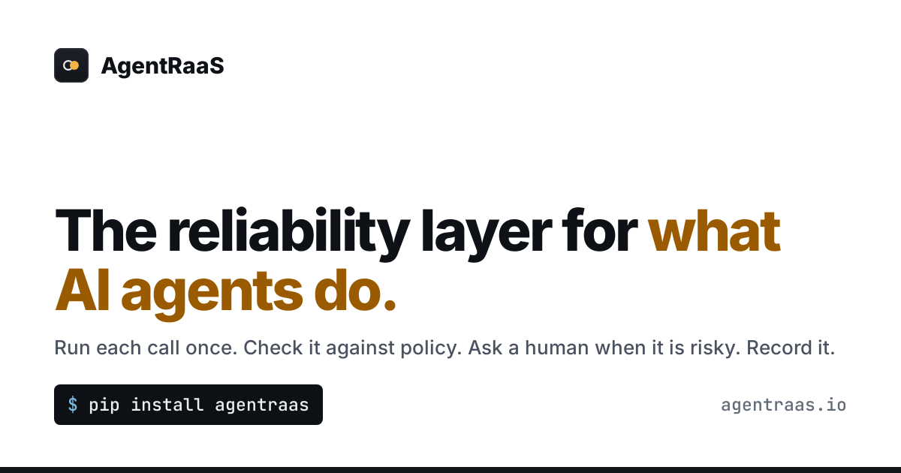
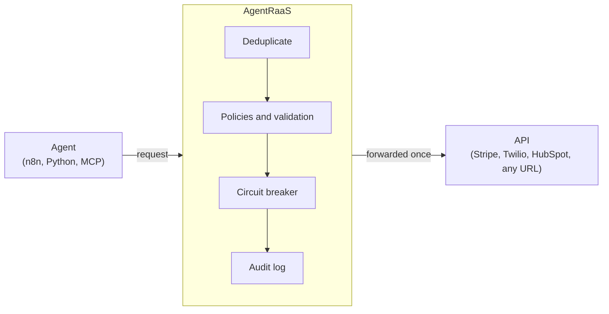

# AgentRaaS

**The reliability layer for what AI agents do.**

AgentRaaS sits between your agents and the APIs they act on. Every call runs
once even when it is retried, is checked against what that agent may do,
waits for a human when it is risky, and is recorded. Connect by webhook URL,
SDK headers or MCP. The core is open source and free to self-host.

Look first: [live read-only demo](https://agentraas.io/api/v1/demo/session),
no signup. Built-in services include Stripe, Slack, GitHub, HubSpot, Resend,
SendGrid, Notion, Zendesk, Jira, Twilio, Shopify, Razorpay, Cashfree, RazorpayX, Gupshup, MSG91, Delhivery, Shiprocket and Alpaca (trading); any other HTTP API works as a
Custom Action and any MCP tool through `agentraas wrap`.

## The problem

Your n8n workflow calls Stripe. It times out, n8n retries, and the customer
is charged twice. Your agent creates a HubSpot contact, the response is
lost, the agent retries, and now there are two.

## How it works



1. Your agent calls AgentRaaS instead of the API.
2. AgentRaaS claims a dedup slot in Redis for that exact request.
3. The first call is forwarded and its result stored.
4. A retry gets the stored result, or `409` while the first is still in flight.

A call that times out after it was sent is treated as **outcome unknown**:
never retried, its slot kept, sent to the dead-letter queue. Every forwarded
call also carries `Idempotency-Key: agentraas-<hash>`, so providers that honor
it (Stripe and others) run it once even on a replay.

## Free tools, no server needed

`pip install agentraas` runs entirely on your machine.

```bash
agentraas chaos --mock -- python my_agent.py   # find calls that would run twice
```

```python
from agentraas.local import exactly_once

@exactly_once()
def charge(customer, amount, idempotency_key=None):
    return stripe.Charge.create(customer=customer, amount=amount, idempotency_key=idempotency_key).id
```

- `protect_tool` for LangChain/LangGraph and CrewAI, `protectTools` for the
  Vercel AI SDK (`npm install agentraas`).
- `agentraas wrap -- <mcp server>` gives any MCP server exactly-once write
  tools and a log. In the [official MCP Registry](https://registry.modelcontextprotocol.io/v0/servers?search=io.github.agentraas/agentraas).
- `agentraas scan` lists which tools in your MCP servers can move money,
  delete data, run code or send messages, without calling any of them
  ([GitHub Action](src/scan-action/action.yml) for pull requests).
- The chaos tester exits non-zero, so it can fail CI ([GitHub Action](src/chaos-action/action.yml)).

Details: [`src/sdk/README.md`](src/sdk/README.md), [`src/sdk-js`](src/sdk-js).

## Self-host

```bash
git clone https://github.com/agentraas/agentraas.git
cd agentraas
./install.sh
```

`install.sh` generates the secrets, builds the image (the first Rust build
takes a few minutes), starts Postgres, Redis and MinIO, and runs the
migrations. Then open `http://localhost:13000/dashboard` and register.
Kubernetes: a Helm chart is in `infra/helm/`. Render: [one-click deploy](https://render.com/deploy?repo=https://github.com/agentraas/agentraas).

Works with Docker or Podman. Linux: either one. macOS: Docker Desktop (or
Colima).
Windows: Docker Desktop with WSL2; run `./install.sh` from a WSL terminal,
with the repo cloned inside WSL (not on `C:\`).

On SELinux hosts, `install.sh` relabels the bind mounts. After changing files
by hand, recreate (`docker compose` or `podman-compose`, `down` then `up -d`)
rather than `restart`.

## What you get

- **Runs once:** dedup across retries and machines, near-duplicate matching,
  step checkpoints, a cross-agent resource lock.
- **Policies:** what each agent may call and where it may send data,
  allowed hours in any time zone, validation rules, call and money caps per
  hour or day, loop limits, and limits read from the provider right before
  the call (a refund at most half of what the order really cost). Quoted
  numbers (`"5000"`) are held to the same limits.
- **One key per agent:** works for every service you connect; switch
  services off per key.
- **Human approval:** risky calls wait for approve or deny from the
  dashboard, Slack, or a one-time link sent to Teams, Telegram, Discord or
  email, with escalation.
- **Resilience:** circuit breaker, rate limits, dead-letter queue with replay.
- **Undo:** an action that ran can be reversed from the dashboard for 30 days
  (Stripe charge refunded, Slack message deleted, or your own reverse action),
  exactly once.
- **Shadow mode:** run an agent on real traffic with its writes recorded and
  checked against your rules but never sent ([docs](https://agentraas.io/docs#shadow-mode)).
- **Record locks:** two agents can't change the same Stripe customer or CRM
  contact at the same moment; the second gets a 409 naming the holder
  ([docs](https://agentraas.io/docs#record-locks)).
- **Savings reports:** duplicates caught, calls blocked, approvals and an
  estimate of the money in duplicate payments stopped, per agent and service,
  as HTML or CSV or a monthly email ([docs](https://agentraas.io/docs#reports)).
- **Audit and identity:** tamper-evident log, SIEM export, OpenTelemetry and
  Prometheus, short-lived scoped agent tokens.
- **Data safety:** PII redaction, prompt-injection filtering on tool output,
  schema drift alerts.
- **Keys:** stored service keys are encrypted (AES-256-GCM); self-hosted, the
  master key can live in Vault, AWS KMS, Google Cloud KMS or Azure Key Vault,
  and Enterprise can leave service keys in your own secrets manager and have
  them fetched per call ([docs](https://agentraas.io/docs#kms)).
- **Teams:** OIDC SSO, roles, client tenants with white-label branding.

Curated services (Stripe, Razorpay, Cashfree, RazorpayX, Gupshup, MSG91, Delhivery, Twilio, HubSpot, Shopify, Slack, PayPal, Alpaca
paper and live trading and more in `config/services.json`), or register any
URL as a Custom Action, SSRF-guarded. Guardrails for trading agents:
[agentraas.io/trading](https://agentraas.io/trading); for agents that refund
orders, message customers and pay riders:
[agentraas.io/commerce](https://agentraas.io/commerce).

## Why not just idempotency keys?

If you only call Stripe from your own code, its `Idempotency-Key` is enough.
AgentRaaS is for the rest: providers without one (most SaaS APIs and every
internal endpoint), no-code tools that can't set headers (n8n, Make, Zapier),
and one audit trail across every service an agent touches.

## When AgentRaaS is down

It fails closed. Nothing in the SDKs, the n8n node or the MCP gateway falls
back to calling the API directly, because that is exactly the unguarded retry
this product exists to stop. Treat it like a database on your critical path.

**Latency:** 2.1 to 2.4 ms added at the median, 2.9 to 3.7 ms at p95, measured
on one machine (Intel Core i3-12100, local stack, three runs of 500 calls) with
`infra/scripts/bench-overhead.py`. A retried duplicate is answered from cache.

## Pricing

| | Self-hosted (Community + Team) | Enterprise |
|---|---|---|
| Price | Free, no license key | [Talk to us](mailto:hello@agentraas.io) |
| Limits | No action limit, up to 3 seats | Unlimited seats |
| Includes | Exactly-once execution, MCP gateway, dashboard, audit trail, DLQ, undo, record and replay, shadow mode, savings reports, record locks, spend caps and action policies, DLP redaction, human approvals, semantic dedup, SSO | Everything in Self-hosted, plus agent identity, inbound webhooks, white-label branding (also on reports), service keys read from your own secrets manager |

AgentRaaS Cloud starts with a free trial of 1,000 actions with every
feature, for trying it out; for production, self-host. The core server is
MIT; the Team and Enterprise features are source-available (see
[LICENSE.md](./LICENSE.md)).

## Testing

```bash
cd src/api-gateway-rs
cargo test --workspace --features enterprise          # unit tests
TEST_BASE_URL=http://localhost:13000 test/run-each.sh # integration tests against a real server, one file at a time (env vars in its header)
```

`infra/tutorials/check_docs.py` re-runs every tutorial case and fails if a
documented response no longer matches the server (CI runs it too); load
test numbers and how to reproduce them are in `infra/bench/README.md`.

The integration tests send concurrent duplicates, replays and failures
through the built-in `mockpay` service, so no real API keys are needed.

## Next

- Verify the undo log against real Stripe and Slack accounts (tested with `mockpay` so far).
- A real test-mode call to Cashfree and RazorpayX (wiring checked with made-up keys only).

## Docs and license

[agentraas.io/docs](https://agentraas.io/docs) has the API, the
[troubleshooting guide](https://agentraas.io/docs#troubleshooting) and
self-hosting details. [agentraas.io/tutorials](https://agentraas.io/tutorials)
walks through every feature, in the dashboard and through the API, with real
responses. Every endpoint as OpenAPI:
[openapi.json](https://agentraas.io/openapi.json). Questions: [agentraas.io/community](https://agentraas.io/community)
(GitHub Discussions).

The server core and the SDKs are MIT. The Team and Enterprise features
(`crates/api/src/ee/`, `crates/core/src/{semantic_dedup,hmac_verify}.rs`,
`compose.ee.yaml`) are source-available under the AgentRaaS Enterprise
License: free to read and try, Team features free in production, Enterprise
features need a license key. Earlier releases keep the license they shipped
under. See [LICENSE.md](./LICENSE.md).

[CONTRIBUTING.md](./CONTRIBUTING.md) · [SECURITY.md](./SECURITY.md) (report
vulnerabilities privately, not as issues) · [CODE_OF_CONDUCT.md](./CODE_OF_CONDUCT.md)

Built with Rust (Axum, Tokio, sqlx), Postgres and Redis.
